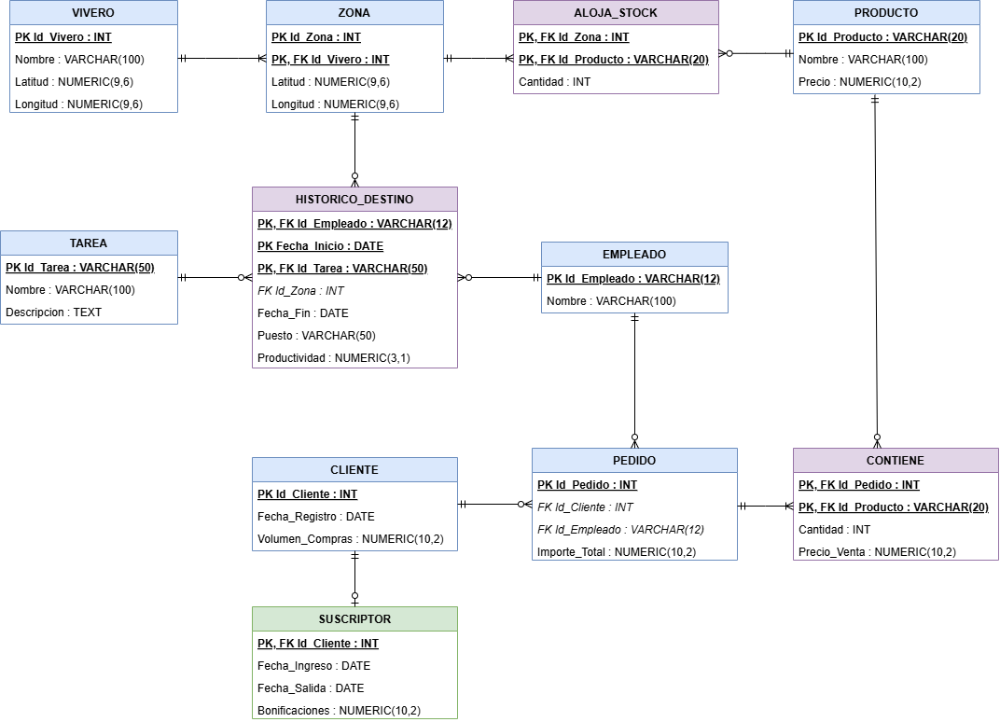

# Práctica 4. Modelo Relacional. Viveros

**Asignatura:** Administración y Diseño de Bases de Datos

**Autores:**

* Francisco Gabriel Ruiz Ruiz (alu0101618586@ull.edu.es)

* Sergio Rosales Calzadilla (alu0101635590@ull.edu.es)

## Imagen del modelo relacional



## Imagen con la salida de un SELECT de cada tabla de la base de datos

### 1. Rama de Infraestructura y Stock (Viveros, Zonas, Aloja_Stock y Productos)

```
viveros=# SELECT 
    v.Nombre AS Nombre_Vivero, 
    z.Id_Zona, 
    p.Nombre AS Producto, 
    p.Precio AS Precio_Base,
    a.Cantidad AS Stock_Disponible
FROM VIVERO v
JOIN ZONA z ON v.Id_Vivero = z.Id_Vivero
JOIN ALOJA_STOCK a ON z.Id_Zona = a.Id_Zona AND z.Id_Vivero = a.Id_Vivero
JOIN PRODUCTO p ON a.Id_Producto = p.Id_Producto
ORDER BY v.Nombre, z.Id_Zona;
```

Resultado:

```
 nombre_vivero | id_zona |      producto      | precio_base | stock_disponible 
---------------+---------+--------------------+-------------+------------------
 Vivero Norte  |       1 | Ficus              |       15.50 |               50
 Vivero Norte  |       2 | Rosal              |        8.20 |              120
 Vivero Sur    |       1 | Abono Universal 5L |       12.00 |              200
 Vivero Sur    |       2 | Maceta Terracota   |        5.50 |               80
(4 rows)
```

### 2. Rama de Recursos Humanos y Operaciones (Empleados, Histórico_Destino, Tareas y Viveros)

```
viveros=# SELECT 
    e.Nombre AS Empleado, 
    t.Nombre AS Tarea, 
    h.Puesto,
    h.Fecha_Inicio, 
    h.Fecha_Fin, 
    h.Productividad,
    v.Nombre AS Vivero_Destino, 
    h.Id_Zona
FROM EMPLEADO e
JOIN HISTORICO_DESTINO h ON e.Id_Empleado = h.Id_Empleado
JOIN TAREA t ON h.Id_Tarea = t.Id_Tarea
LEFT JOIN VIVERO v ON h.Id_Vivero = v.Id_Vivero
ORDER BY e.Nombre;
```
Resultado:

```
  empleado   |      tarea       |  puesto   | fecha_inicio | fecha_fin  | productividad | vivero_destino | id_zona 
-------------+------------------+-----------+--------------+------------+---------------+----------------+---------
 Jorge Díaz  | Atención Cliente | Asesor    | 2026-04-10   |            |          88.0 |                |        
 Luis Pérez  | Poda             | Podador   | 2026-02-15   |            |          90.0 | Vivero Norte   |       2
 Marta Gómez | Abonado          | Jardinero | 2026-05-20   | 2026-06-20 |          82.5 | Vivero Este    |       1
(3 rows)
```

### 3. Rama Comercial y Ventas (Clientes, Suscriptores, Pedidos y Contiene)

```
viveros=# SELECT 
    c.Id_Cliente, 
    c.Volumen_Compras,
    s.Bonificaciones,
    ped.Id_Pedido, 
    ped.Importe_Total, 
    prod.Nombre AS Producto_Comprado, 
    con.Cantidad, 
    con.Precio_Venta
FROM CLIENTE c
LEFT JOIN SUSCRIPTOR s ON c.Id_Cliente = s.Id_Cliente
JOIN PEDIDO ped ON c.Id_Cliente = ped.Id_Cliente
JOIN CONTIENE con ON ped.Id_Pedido = con.Id_Pedido
JOIN PRODUCTO prod ON con.Id_Producto = prod.Id_Producto
ORDER BY c.Id_Cliente, ped.Id_Pedido;
```

Resultado:

```
 id_cliente | volumen_compras | bonificaciones | id_pedido | importe_total | producto_comprado | cantidad | precio_venta 
------------+-----------------+----------------+-----------+---------------+-------------------+----------+--------------
        101 |          150.00 |          15.00 |      1001 |         31.00 | Ficus             |        2 |        15.50
        102 |          450.50 |          45.00 |      1002 |         16.40 | Rosal             |        2 |         8.20
        105 |           45.00 |           4.50 |      1005 |         11.00 | Maceta Terracota  |        2 |         5.50
(3 rows)
```
